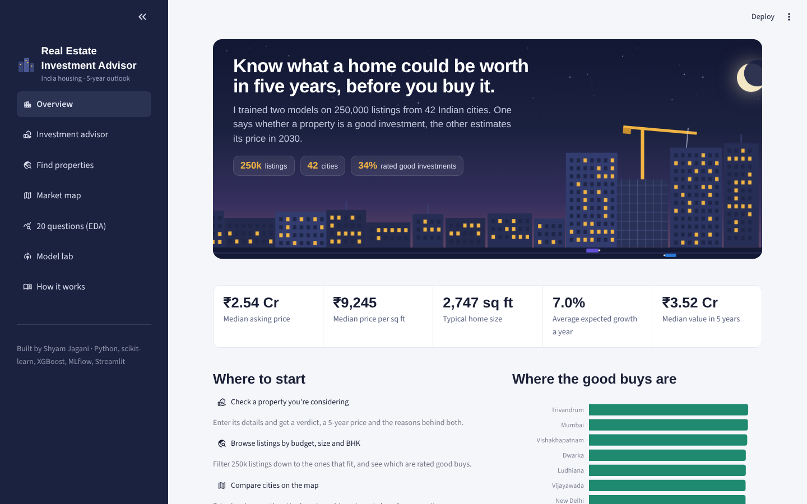
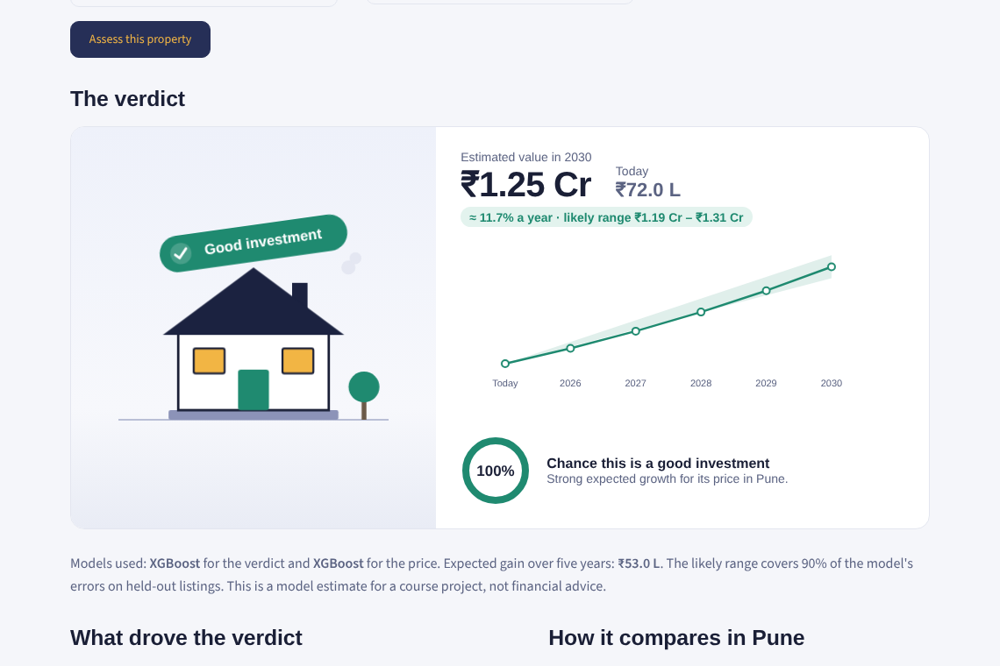
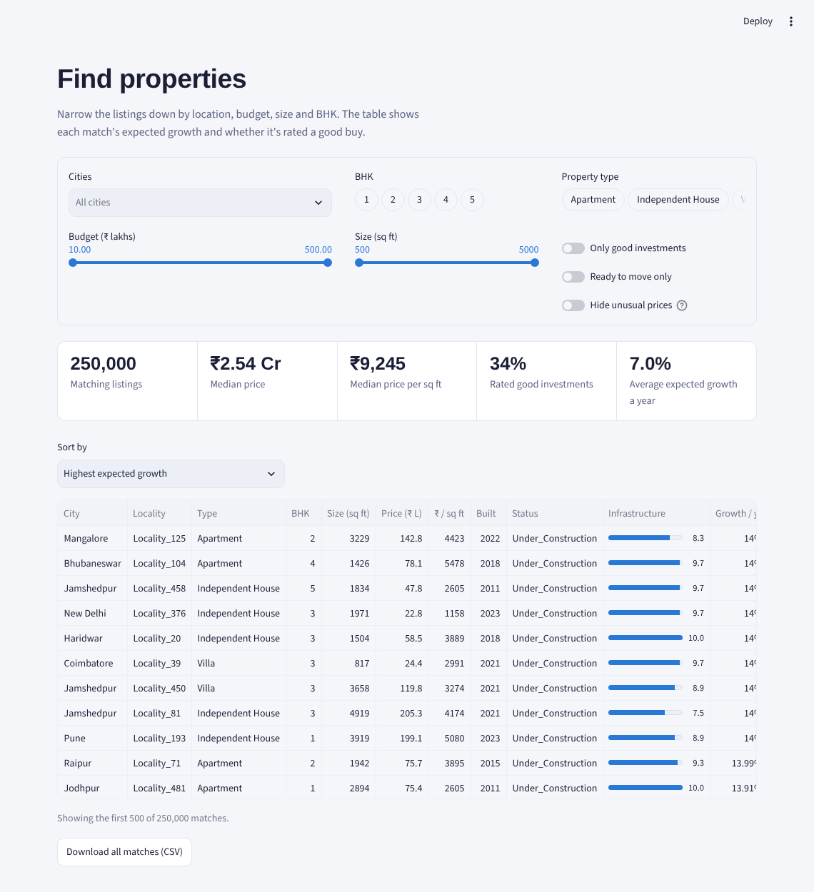
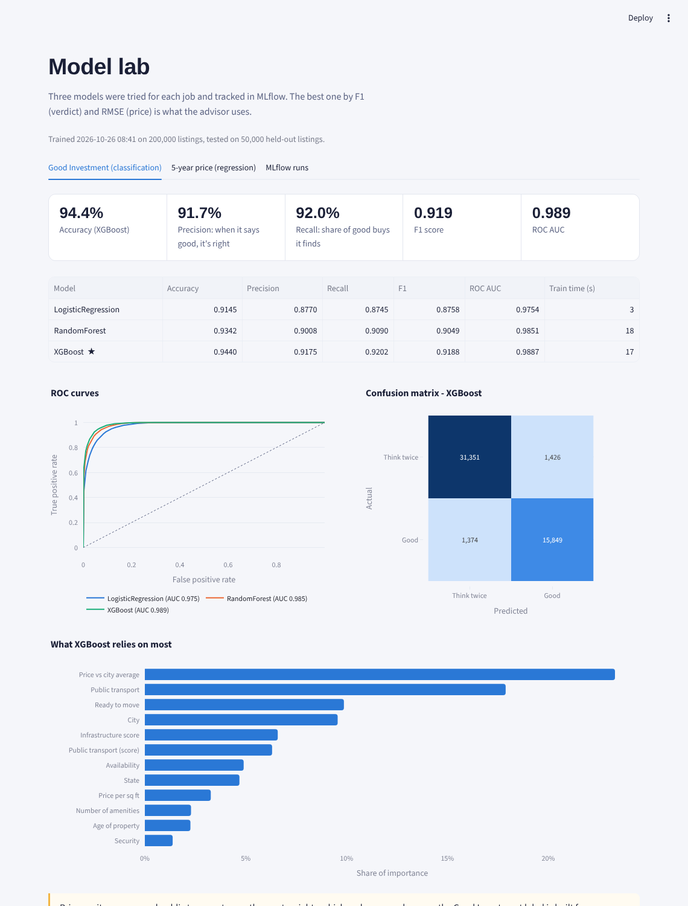

# Real Estate Investment Advisor

**Predicting property profitability and future value for Indian housing.**

A machine-learning app that answers two questions a buyer actually asks:

1. **Is this property a good investment?** (classification)
2. **What will it be worth in 5 years?** (regression)

It's built on 250,000 listings from 42 Indian cities. The pipeline cleans and engineers the data, answers 20 EDA questions, compares six models with MLflow tracking, and serves the best two through an animated Streamlit app.

> Domain: Real Estate · Investment · Financial Analytics
> Stack: Python, Pandas, scikit-learn, XGBoost, MLflow, Plotly, Streamlit

---

## What's in the app

| Page | What you can do |
|---|---|
| **Overview** | Animated city skyline, headline numbers, and the cities with the most good buys |
| **Investment advisor** | Enter a property and get a verdict, a 5-year price with a likely range, the model's confidence, the features that drove the call, and similar listings. The result plays as an animation: a house builds itself, the verdict lands, the price counts up and the growth line draws |
| **Find properties** | Filter by city, BHK, budget, size and type, sort by growth or value, and download the matches |
| **Market map** | Map of India coloured by price, growth or good-buy share; a state × property-type heatmap; the four Step 2 analyses from the brief |
| **20 questions (EDA)** | Every EDA question from the brief, each with a chart and a takeaway calculated from the data |
| **Model lab** | All six models compared: metrics, ROC curves, confusion matrix, feature importance, actual vs predicted, and the MLflow run log |
| **How it works** | Cleaning steps, engineered features, how the targets are defined, and honest limits |

### Screenshots

| Overview | Investment advisor |
|---|---|
|  |  |
| **Find properties** | **Model lab** |
|  |  |

---

## Results

Trained on 200,000 listings, tested on 50,000 held-out listings. All six runs are tracked in MLflow.

**Is it a good investment?** (classification, 34% of listings are positive)

| Model | Accuracy | Precision | Recall | F1 | ROC AUC |
|---|---|---|---|---|---|
| Logistic Regression | 0.915 | 0.877 | 0.875 | 0.876 | 0.975 |
| Random Forest | 0.934 | 0.901 | 0.909 | 0.905 | 0.985 |
| **XGBoost** ★ | **0.944** | **0.918** | **0.920** | **0.919** | **0.989** |

**Price in 5 years** (regression, ₹ lakhs)

| Model | RMSE | MAE | MAPE | R² |
|---|---|---|---|---|
| Linear Regression | 20.74 | 15.98 | 10.0% | 0.988 |
| Random Forest | 13.18 | 9.36 | 2.7% | 0.995 |
| **XGBoost** ★ | **11.63** | **8.21** | **2.4%** | **0.996** |

The 5-year price comes with a likely range of roughly ±5%, covering 90% of the model's errors on held-out data. The verdict's strongest drivers are **price vs city median**, **public transport** and **ready-to-move vs under construction**.

---

## How the targets are defined

The dataset has today's prices but **no price history**, so I built an *expected yearly appreciation rate* for each listing from factors that move Indian property prices:

- a base of **6% a year** (long-run average for Indian residential)
- **+ infrastructure**: schools, hospitals and public transport, combined into a 0-10 score
- **+ value gap**: priced below the city median means room to catch up; overpriced homes lose growth
- **+ new-launch premium** for under-construction homes
- **− age**: a small penalty per year
- **+ amenities, security, parking**, and the easy-to-resell 2-3 BHK sizes
- a little random noise, because real markets never follow a formula exactly

Then:

- **`Future_Price_5Y`** = price × (1 + rate)⁵. This is the regression target.
- **`Good_Investment`** = 1 if the rate is ≥ **7.5% a year** *and* the price is no more than **15% above the city median**. This is the classification target.

Every threshold lives in `src/config.py`.

---

## Project structure

```
real-estate-investment-advisor/
├── app.py                     # Streamlit entry point (sidebar + navigation)
├── app_pages/                 # one file per app page
├── utils/
│   ├── anim.py                # skyline + house-build animations (HTML/SVG/CSS)
│   ├── data.py                # cached loaders, prediction + explanation helpers
│   └── style.py               # fonts, colours, layout helpers
├── src/
│   ├── config.py              # paths, rules, thresholds
│   ├── preprocessing.py       # Step 1: cleaning + feature engineering + targets
│   ├── eda_questions.py       # the 20 questions + 4 Step-2 analyses (shared with the app)
│   ├── eda.py                 # Step 2: exports every chart + reports/eda_findings.md
│   ├── train.py               # Steps 3-4: 6 models, MLflow tracking + registry
│   └── plot_theme.py          # one chart style for everything
├── data/
│   ├── raw/india_housing_prices.csv.gz        # original data, gzipped (7 MB)
│   └── processed/housing_clean.csv.gz         # cleaned data, gzipped (14 MB)
│       processed/housing_clean.parquet        # same data, what the app loads (9 MB)
├── models/                    # classifier.joblib, regressor.joblib, model_metadata.json
├── reports/
│   ├── figures/               # all EDA charts (HTML + PNG)
│   ├── eda_findings.md        # takeaway for every question
│   ├── cleaning_log.json
│   └── mlflow_runs.csv        # export of every MLflow run
├── docs/PROJECT_REPORT.md     # methodology, findings, use cases
├── .streamlit/config.toml     # theme
├── requirements.txt           # app
└── requirements-train.txt     # app + MLflow + plotting
```

---

## Run it locally

```bash
git clone https://github.com/<your-username>/real-estate-investment-advisor.git
cd real-estate-investment-advisor
python -m venv .venv && source .venv/bin/activate     # Windows: .venv\Scripts\activate
pip install -r requirements-train.txt

# The cleaned data and trained models are already in the repo, so the app runs straight away:
streamlit run app.py
```

> **About the data files:** the CSVs are stored gzipped so every file stays under GitHub's upload limit. pandas reads them directly (`pd.read_csv("data/processed/housing_clean.csv.gz")`). To open one in Excel, unzip it first (7-Zip or WinRAR on Windows, or double-click on Mac).

To rebuild everything from the raw CSV:

```bash
python src/preprocessing.py     # ~10 s  -> data/processed/
python src/eda.py               # ~1 min -> reports/figures/, reports/eda_findings.md
python src/train.py             # ~4 min -> models/, mlflow.db, reports/mlflow_runs.csv
                                # (add --quick to train on a 60k sample)
```

Browse the experiments in MLflow:

```bash
mlflow ui --backend-store-uri sqlite:///mlflow.db
# open http://127.0.0.1:5000  -> experiment "real-estate-investment-advisor"
```

---

## Deploy on Streamlit Community Cloud

1. Push the repo to GitHub. `mlruns/` and `mlflow.db` are git-ignored; the app doesn't need them.
2. Go to [share.streamlit.io](https://share.streamlit.io) → **Create app** → pick the repo, branch `main`, main file `app.py`.
3. Under **Advanced settings**, choose **Python 3.13** (the models were trained on 3.13 with scikit-learn 1.9.1).
4. Deploy. The app installs from `requirements.txt` only, which is kept light on purpose (no MLflow).

---

## Honest notes

- **Both targets come from rules I wrote**, so the models learn those rules. High accuracy shows they capture them well, not that they forecast the real market. With real resale histories, the same pipeline could be retrained on actual price changes.
- **The listings look randomly generated.** Price has no relationship with size (r ≈ 0), and average prices differ by only about 3% between the cheapest and most expensive city. The EDA reports this plainly instead of inventing patterns.
- **46.5% of rows list a floor higher than the building's total floors.** These are capped at the top floor during cleaning.
- **There's no crime-rate column**, so the Security flag stands in as a crime-risk proxy. **There are no sale dates**, so "price trends" use year built as the timeline.
- `Price_per_SqFt` in the raw file is in lakhs per sq ft. I recalculate it in rupees from price and size.

---

*Built by Shyam Jagani. Not financial advice.*
